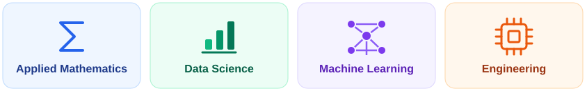

# Hi, I'm Alec

I'm an **Applied Mathematics** student at **Emory**, planning to follow the **Emory–Georgia Tech dual-degree path in Computer Engineering**. I'm interested in **Data Science**, **Machine Learning**, and **Engineering**. This profile brings together my coursework and coding projects.

## Selected Projects

- **[Classification of recorded diabetes outcomes](https://github.com/AlecAnghel/diabetes-prediction-project)**: An educational Python and scikit-learn project focused on model evaluation.
- **[Formula 1 statistical analysis](https://github.com/AlecAnghel/F1_Statistical-Analysis_GroupProject)**: A group project exploring Formula 1 data through statistical analysis.
- **[Student performance and lifestyle](https://github.com/AlecAnghel/r-health_lifestyle_computing_project)**: An R project exploring student performance and lifestyle data.

## Languages and Tools

Python, R, Java, SQL, pandas, NumPy, and scikit-learn.

## Connect

You can find me on [LinkedIn](https://www.linkedin.com/in/alec-anghel-1a19a2322) or explore more of my work on [my personal GitHub](https://github.com/aaxel24).
